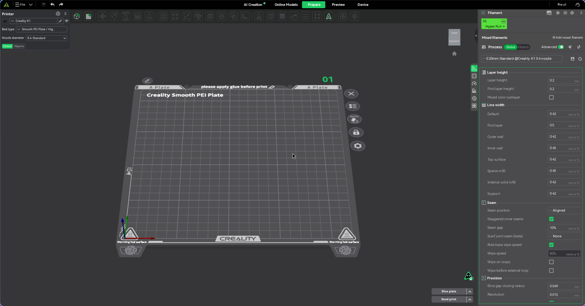

# creality-print-nix



Nix flake packaging the official upstream binary of [creality-print](https://github.com/CrealityOfficial/CrealityPrint). This project is not affiliated with or endorsed by upstream.

## Usage

Requires Nix with flakes enabled and x86_64 Linux. From this directory:

```sh
nix run .
nix build .
./result/bin/creality-print
```

For a NixOS configuration, add this repository as a flake input and use `inputs.<input-name>.packages.${pkgs.stdenv.hostPlatform.system}.default` in `environment.systemPackages`. Replace `<input-name>` with your chosen input name. The flake pins nixpkgs in `flake.lock`; update deliberately with `nix flake update nixpkgs`.

## NixOS module

Add the input to your NixOS flake (replace the path with the location of this checkout, or use a repository URL):

```nix
inputs.creality-print.url = "path:/absolute/path/to/creality-print-nix";
```

Import and enable the module in your `nixosSystem` definition:

```nix
outputs = { nixpkgs, creality-print, ... }: {
  nixosConfigurations.my-machine = nixpkgs.lib.nixosSystem {
    system = "x86_64-linux";
    modules = [
      ./configuration.nix
      creality-print.nixosModules.default
      {
        programs.creality-print.enable = true;
        # Optional: use X11/XWayland instead of the native Wayland backend.
        programs.creality-print.useX11 = true;
      }
    ];
  };
};
```

Both options default to `false`. Enabling the module installs the package from this flake; it does not configure graphics drivers, a desktop environment, or XWayland. `useX11` applies only when the module is enabled. For a Git-based input, commit or stage new files before evaluating the flake so Nix can see them.

## Version and licensing

Upstream version: **7.3.1 (build 6378)**. The upstream download URL and integrity hash are in `package.nix`.

The package metadata identifies the application as AGPL-3.0-only; see the [upstream repository](https://github.com/CrealityOfficial/CrealityPrint) and the distributed binary for license and component details. This repository does not redistribute the upstream binary; Nix downloads it from upstream. Check the upstream terms before use or redistribution. No license is asserted here for the packaging files.

## Known limitations

The upstream x86-64 Linux AppImage runs in an FHS environment. Printer connectivity, GPU drivers, WebKit features and graphical operation depend on the host and have not been comprehensively tested. Only x86_64 Linux is provided. Download availability depends on upstream; the fixed hash protects integrity but does not guarantee availability.

On systems with fractional-scaling problems under native Wayland, the package can be overridden with `useX11 = true`; this selects XWayland and the system CA bundle for Creality Print. XWayland and a working X display are required. For example, when using the flake package in NixOS:

```nix
environment.systemPackages = [
  (inputs.creality-print.packages.${pkgs.stdenv.hostPlatform.system}.default.override { useX11 = true; })
];
```
